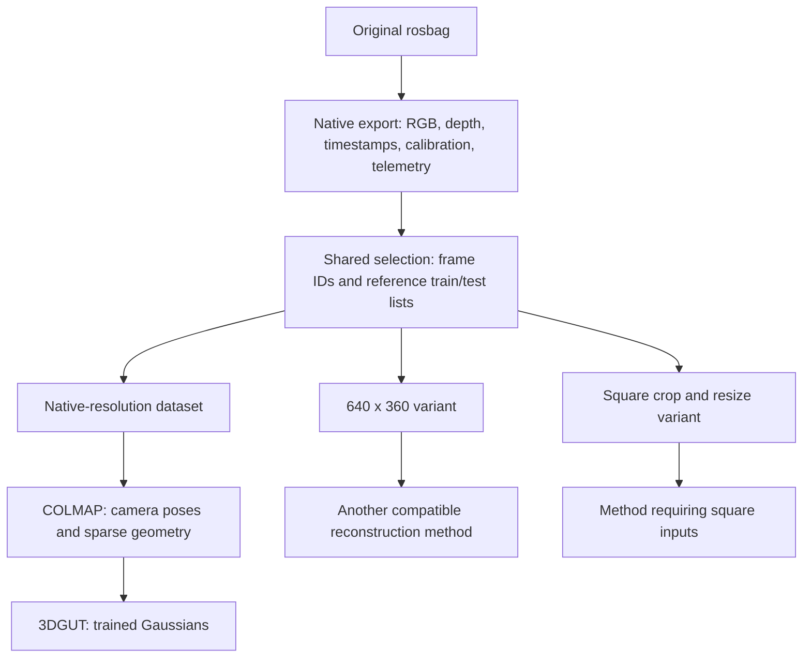

# Extract once, reuse across reconstruction methods

The rosbag is the original recording. Decode it once into a native export, choose a shared set of frames, and create a derived dataset only when a method needs different dimensions or inputs. Reuse an existing dataset when its requirements already match. These steps do not require a GPU.



## Folder layout

```text
Workflow/
  Data/
    rosbags/RECORDING/                original source
    exports/RECORDING/native/         decode once, preserve native resolution
    extract_rosbag.py                 bag decoding/export
    dataset_tools.py                  select, variant, validate
  Calibration/                       calibration and synchronization notes
  Reconstruction/
    datasets/SHARED/                  selected native images and metadata
    datasets/METHOD_VARIANT/          transformed images and calibration
    runs/                            checkpoints, configuration, logs
    mono_workflow.py                  COLMAP/training launcher; legacy bag preparation
  Evaluation/                        comparison policy and future metrics
```

Generated images, raw data, and model outputs are ignored by Git. Scripts and instructions are tracked. Use paths relative to this project's root in the commands below.

## 1. Export a new recording once

After installing `Workflow/Data/requirements.txt` into `Workflow/Data/.venv`, run:

```bash
Workflow/Data/.venv/bin/python Workflow/Data/extract_rosbag.py \
  --bag Workflow/Data/rosbags/flight_rgbd_20261025_024629 \
  --all --image-rate 0 \
  --rgb-topic /camera_full/color/image_raw/compressed \
  --depth-topic /camera_full/aligned_depth_to_color/image_raw/compressedDepth \
  --output Workflow/Data/exports/flight_rgbd_20261025_024629/native
```

This preserves the full image stream. `--image-rate 0` means all recorded frames; sampling here would permanently limit what later selections can recover from this export. Native means the recorded pixels/resolution, not uncompressed sensor RAW; the recorded RGB messages were JPEG-compressed already. RGB PNG export adds no further lossy encoding.

The included October 25 native export was created locally and verified to contain 1,009 RGB and 1,010 depth frames plus recorded calibration/telemetry. It takes approximately 5.3 GB. Do not rerun extraction if this complete export already exists on the same machine. Exports and environments are not included in a Git clone; create or copy the export separately on the remote machine.

## 2. Select shared views from that export

```bash
Workflow/Data/.venv/bin/python Workflow/Data/dataset_tools.py select \
  --export Workflow/Data/exports/flight_rgbd_20261025_024629/native \
  --name oct25_shared_native \
  --start 12 --end 130 --rate 3 \
  --camera-info-topic /camera/camera/color/camera_info \
  --test-every 8 --with-depth
```

This reads exported files, not the rosbag. It creates `Workflow/Reconstruction/datasets/oct25_shared_native/` with:

| File/folder | Meaning |
| --- | --- |
| `images/` | Copied native RGB frames |
| `depth/` | Associated aligned depth arrays in metres, when available |
| `frames.csv` | Stable frame IDs, source timestamps, split labels, and depth association residuals |
| `calibration.json` | Current image dimensions and fixed COLMAP-format intrinsics/distortion |
| `splits.json` | Reference training/test image lists |
| `dataset.json` | Parameters, source manifest hash, completion status, and provenance |

For this selection, the local result is 296 RGB frames, with 259 reference training and 37 reference test frames. Test frames are indices 0,8,16,... in selected time order. `--test-every 0` labels all frames as train. Existing dataset names are refused.

Review images before deciding the comparison set. To reject frames, write source-export PNG filenames into a text file, one per line, and create a new selection with `--exclude-file FILE`. Lines beginning with `#` are comments. Do not alter the shared selection after creating variants; use a new name so frame identities and reference splits remain reproducible.

### Depth timing is explicit

`--with-depth` associates already-aligned depth by nearest sensor-header timestamp, with a default maximum difference of 0.04 seconds. It does not geometrically align depth or interpolate poses. Missing matches are kept as empty depth fields. Add `--require-depth` to reject a selection if even one RGB frame lacks a match. `--depth-clock bag` explicitly uses receipt timestamps instead, and `--max-depth-dt SECONDS` changes the tolerance; do not widen tolerances without checking motion and clocks.

In the October 25 shared selection, 183 of 296 frames have a depth match within 40 ms; 113 do not. The tool retains all RGB frames for the RGB baseline and records those gaps. This is not a fully synchronized RGB-D dataset. A future RGB-D experiment must choose its usable subset deliberately and record the difference in inputs.

## 3. Make a method-specific size only when needed

Half resolution, preserving the full image field of view:

```bash
Workflow/Data/.venv/bin/python Workflow/Data/dataset_tools.py variant \
  --source Workflow/Reconstruction/datasets/oct25_shared_native \
  --name oct25_half_640x360 --width 640 --height 360
```

Square crop followed by resizing:

```bash
Workflow/Data/.venv/bin/python Workflow/Data/dataset_tools.py variant \
  --source Workflow/Reconstruction/datasets/oct25_shared_native \
  --name oct25_square_448 \
  --center-crop 720 720 --width 448 --height 448
```

This crops a centred 720×720 region from the native 1280×720 image, then resizes to 448×448. It is a calibrated square-input example, not a promise that every model uses exactly this preprocessing. Follow each model's actual resize/crop/normalization rules; avoid preprocessing twice when its loader already does it.

Other controls:

- `--crop X Y W H`: integer crop in the source image, applied before resizing.
- `--width W` alone or `--height H` alone: calculate the other dimension to preserve aspect ratio.
- `--allow-stretch`: explicitly permit different horizontal/vertical scales. Default rejects a substantial aspect-ratio change; cropping first is usually preferable.

Variants keep frame IDs, timestamps, depth matches, and reference splits. RGB uses area downsampling or linear upsampling; depth uses nearest-neighbor-exact interpolation, retaining metres and invalid samples without averaging foreground/background depths. Variants do not copy or transform COLMAP model files; creating resized images is not a pose-format conversion.

Validate before use:

```bash
Workflow/Data/.venv/bin/python Workflow/Data/dataset_tools.py validate \
  --dataset Workflow/Reconstruction/datasets/oct25_half_640x360
```

Validation checks completion, indexed filenames, split consistency, calibration dimensions, and depth dimensions/dtype. Source manifest hashes identify metadata; this is not a cryptographic hash of every pixel file.

## 4. Run reconstruction

Use the native selection for the first COLMAP run:

```bash
python3 Workflow/Reconstruction/mono_workflow.py colmap \
  --dataset Workflow/Reconstruction/datasets/oct25_shared_native
```

After inspecting a successful sparse reconstruction:

```bash
conda activate 3dgrut
python Workflow/Reconstruction/mono_workflow.py train \
  --dataset Workflow/Reconstruction/datasets/oct25_shared_native \
  --tool-dir ~/tools/3dgrut --max-gaussians 500000 --workers 2
```

The COLMAP helper reads the variant's `calibration.json`, so a resized selection can also be reconstructed independently. To reuse one already-estimated COLMAP model across trainers, use its undistorted dataset with each trainer's supported loader. Do not replace its image files with different dimensions while leaving its camera files unchanged. A dedicated pose-format/resize adapter is needed for other layouts.

The original convenience command still works. It can now also select from an export:

```bash
python3 Workflow/Reconstruction/mono_workflow.py prepare \
  --export Workflow/Data/exports/flight_rgbd_20261025_024629/native \
  --name another_selection --start 12 --end 130 --rate 3 \
  --camera-info-topic /camera/camera/color/camera_info
```

`prepare --bag` remains the older combined extraction/preparation route. Prefer the separate export/select/variant route for comparing several methods. Existing datasets and COLMAP runs are unchanged by this update.

## 5. Comparison policy

`splits.json` is a reference contract, not an automatic integration with every model. The current NVIDIA trainer has its own periodic split over registered frames; our launcher does not override it with these lists. Missing registrations or different loader ordering can change its actual split. Before reporting a common held-out-view comparison, adapt/audit each method's real training and evaluation lists against the reference IDs. No new image-quality metric or external-training adapter is implemented here.

Use the same scene and test viewpoints, identify RGB-only versus RGB-D or pose-assisted inputs, and record original/working resolutions, crops, time sampling, rejected frames, runtime, peak memory, and software revision. Predicted poses and reference poses must be distinguished. A method that sees the proposed test RGB frames at inference has not held them out from reconstruction.

## Intrinsics when changing resolution

For an ideal camera, `u = fx X/Z + cx` and `v = fy Y/Z + cy`. Intrinsics describe the projection onto the pixel grid:

- `fx, fy`: focal lengths measured in pixels.
- `cx, cy`: principal point coordinates in pixels.
- Distortion coefficients: describe normalized lens distortion separately.

An ordinary crop or resize changes the pixel grid, not the physical camera pose. Therefore extrinsics do not change, but intrinsics do.

The stored `calibration.json` uses COLMAP's half-integer pixel-centre convention. Crop `(x0,y0,w,h)` first, then resize to `(W',H')`, with `sx=W'/w`, `sy=H'/h`:

```text
fx' = sx fx           fy' = sy fy
cx' = sx (cx - x0)    cy' = sy (cy - y0)
```

The normalized distortion coefficients remain unchanged for this operation. If you undistort, the output lens model/calibration must instead come from the undistortion operation.

For the October 25 camera:

| Stored COLMAP parameter | Native 1280×720 | Half-size 640×360 |
| --- | ---: | ---: |
| fx | 643.6353 | 321.8176 |
| fy | 642.9296 | 321.4648 |
| cx | 644.4296 | 322.2148 |
| cy | 364.9224 | 182.4612 |

For a crop without resizing, `fx,fy` stay the same and `cx,cy` shift by the crop offset. Thus cropping a 448×448 region from an image is different from resizing the entire image to 448×448: the crop loses field of view.

ROS/OpenCV uses integer-centred coordinates. With OpenCV's half-pixel resize sampling, the equivalent formula is `cx' = sx*(cx - x0 + 0.5) - 0.5`, and similarly for `cy`; `fx' = sx*fx`. Our tool stores COLMAP coordinates consistently, avoiding this half-pixel ambiguity. [COLMAP coordinate conventions](https://colmap.github.io/faq.html#using-calibration-from-opencv-kalibr-or-other-tools)

Depth Z values stay in metres when images are resized or cropped: a surface at 3 m remains at 3 m. Pixel dimensions and focal lengths change; physical distances do not.
